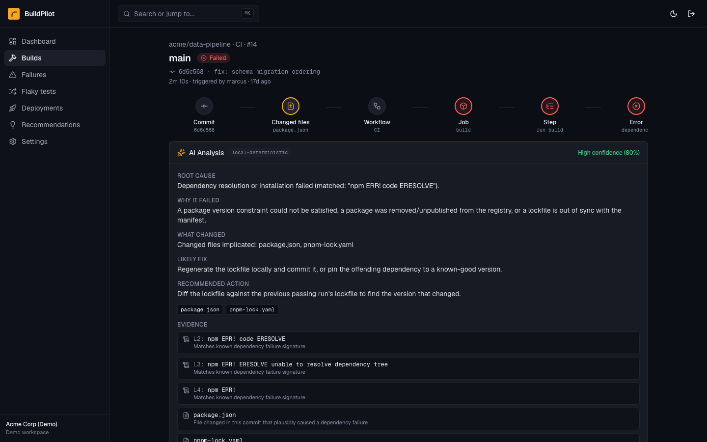
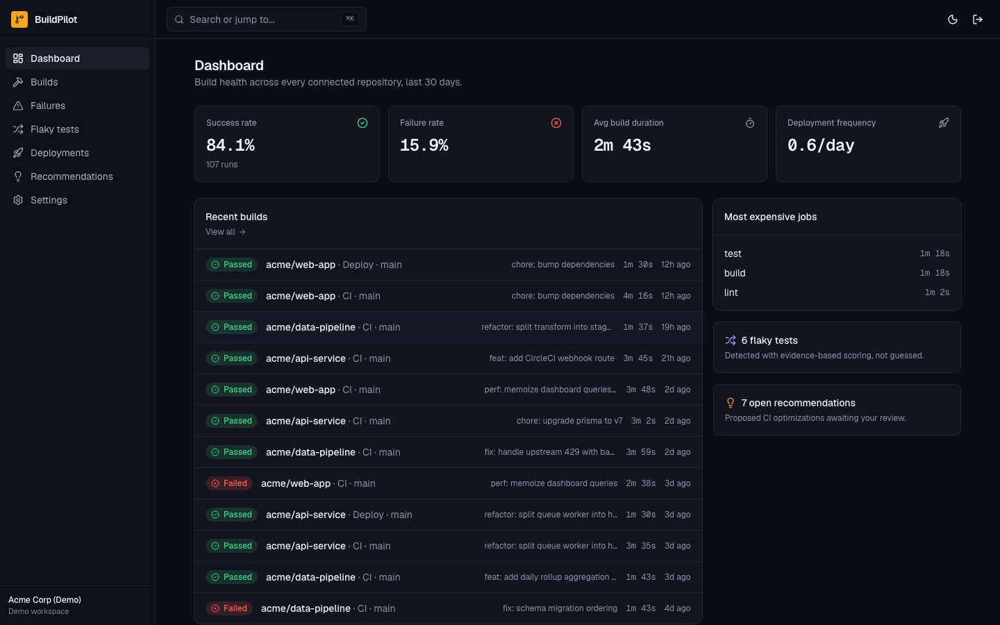
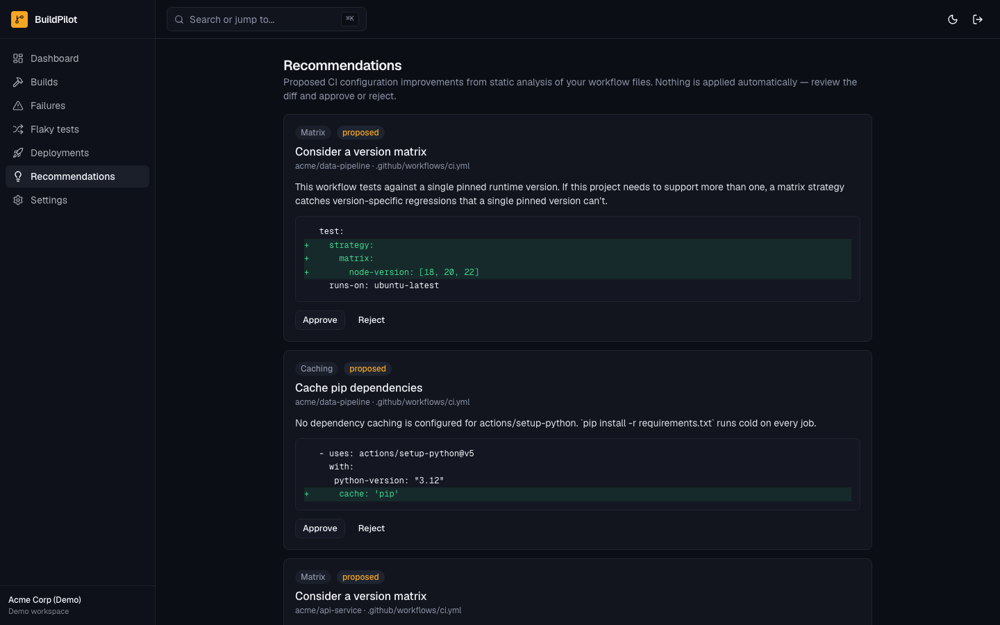
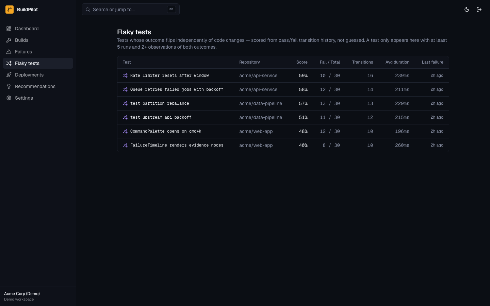

# BuildPilot

**AI-powered CI/CD intelligence — root causes, not raw logs.**

A failed build shouldn't cost a developer 30 minutes of scrolling through
logs. BuildPilot connects to your CI provider, watches your builds, and when
one fails, tells you *why* — with cited evidence, not a guess — and what to
do about it.

```
CODE CHANGE → CI PIPELINE → LOGS + TESTS + METRICS → ANALYSIS → ROOT CAUSE → RECOMMENDED FIX
```

[](https://github.com/itsshreyasbhardwaj-design/buildpilot/actions/workflows/ci.yml)
[](LICENSE)

## Why

CI intelligence tools either wrap a dashboard around raw provider data, or
they're a generic chatbot bolted onto a build log. BuildPilot is neither:
it's a deterministic, evidence-based analysis engine — every root cause it
reports is backed by a citation into the actual log or diff, and it says
"I don't know" (loudly, with low confidence) rather than fabricate a plausible
one. See [`docs/AI_SAFETY.md`](docs/AI_SAFETY.md).

## What it looks like

The failure timeline — the thing this project is actually for — traces a
build failure from commit to root cause as a real, evidence-linked chain,
not a wall of log text:

```
● Commit  ──  ● Changed files  ──  ● Workflow  ──  ● Job  ──  ● Step  ──  ● Error  ──  ✦ Root cause
```

Below it, an AI Analysis card shows root cause, why it failed, what changed,
the likely fix, a calibrated confidence score, and every piece of evidence
cited — line numbers, matched log text, correlated changed files, prior
occurrences.



<details>
<summary>More screenshots — dashboard, CI Optimizer, flaky tests</summary>

**Dashboard** — build health across every connected repository:



**Recommendations** — CI Optimizer findings, each a real diff against a real workflow file, approved or rejected explicitly:



**Flaky tests** — scored from real pass/fail transition history, not guessed:



</details>

All four screenshots are of the demo workspace (`pnpm db:seed`) running a
production build — nothing staged or mocked for the README.

### Example failure analysis

Given a log excerpt like:

```
npm ERR! code ERESOLVE
npm ERR! ERESOLVE unable to resolve dependency tree
npm ERR! peer react@"^19.0.0" from @radix-ui/react-slot@1.3.3
```

BuildPilot returns:

```json
{
  "category": "dependency",
  "rootCause": "Dependency resolution or installation failed (matched: \"npm ERR!\").",
  "whyItFailed": "A package version constraint could not be satisfied, a package was removed/unpublished from the registry, or a lockfile is out of sync with the manifest.",
  "likelyFix": "Regenerate the lockfile locally and commit it, or pin the offending dependency to a known-good version.",
  "confidence": 0.8,
  "relevantFiles": ["package.json", "pnpm-lock.yaml"],
  "recommendedAction": "Diff the lockfile against the previous passing run's lockfile to find the version that changed."
}
```

This is real output from `pnpm benchmark` (`docs/BENCHMARK.md`), not a
hand-written example.

## Architecture

```
┌─────────────┐   webhook    ┌──────────────────┐   enqueue   ┌─────────────────┐
│ GitHub /     │ ───────────▶ │ Signature verify  │ ──────────▶ │ ingest-event     │
│ GitLab /     │              │ + idempotency     │             │ worker           │
│ CircleCI     │              │ (route handler)   │             │ (normalize CI    │
└─────────────┘              └──────────────────┘             │  payload → DB)   │
                                                                 └────────┬────────┘
                                                                          │ on failure
                                                                          ▼
┌──────────────┐   reads    ┌──────────────────┐            ┌──────────────────┐
│ Dashboard /   │◀────────── │ SQLite / Postgres │◀────────── │ analyze-failure   │
│ REST API /    │            │ (Prisma)          │            │ worker            │
│ SDK / MCP     │            └──────────────────┘            │ (evidence-based    │
└──────────────┘                                              │  AI analysis)     │
                                                                └──────────────────┘
```

Every external integration point — CI provider, auth, AI, background queue —
is an interface with a registry that picks the implementation, usually via
an env var. Adding a fifth CI provider means implementing one interface and
registering it; nothing else changes. Full write-up: [`docs/ARCHITECTURE.md`](docs/ARCHITECTURE.md).

## Supported CI providers

| Provider | Webhook verification | Payload normalization | Log fetching |
| --- | --- | --- | --- |
| GitHub Actions | ✅ HMAC-SHA256 | ✅ | ✅ (needs `GITHUB_APP_TOKEN`) |
| GitLab CI | ✅ static token | ✅ | ✅ (needs `GITLAB_ACCESS_TOKEN`) |
| CircleCI | ✅ HMAC-SHA256, key rotation | ✅ | ✅ (needs `CIRCLECI_API_TOKEN`) |

See [`docs/GITHUB_APP.md`](docs/GITHUB_APP.md) for connecting a real
repository — there's no self-serve installation UI yet (tracked in
[`docs/ROADMAP.md`](docs/ROADMAP.md)).

## Quickstart

Zero external accounts, zero paid API keys, zero Docker. Works entirely
offline after `pnpm install`.

```bash
git clone https://github.com/itsshreyasbhardwaj-design/buildpilot.git
cd buildpilot
pnpm install
pnpm db:migrate
pnpm db:seed      # optional — first login does this automatically
pnpm dev
```

Open `http://localhost:3000`, click **Continue with demo workspace** — no
account, no credentials. You'll land on a dashboard with 3 synthetic
repositories, ~30 days of build history, real (not hardcoded) AI failure
analyses, flaky test detection, and CI Optimizer recommendations. See
[`docs/DEMO_MODE.md`](docs/DEMO_MODE.md) for exactly what's generated and how.

### Requirements

- Node.js ≥ 20.9, pnpm ≥ 9

That's the entire list. The default configuration uses SQLite (via
`@prisma/adapter-better-sqlite3`) and a SQLite-backed background queue — no
Postgres, Redis, or Docker required. See [`docs/DATABASE.md`](docs/DATABASE.md)
for switching to Postgres/Supabase in production.

## Configuration

All optional — the app runs with none of these set.

| Variable | Purpose |
| --- | --- |
| `DATABASE_URL` | Defaults to `file:./prisma/dev.db` |
| `AUTH_SECRET` | Session signing key (required in production) |
| `AUTH_PROVIDER=clerk` | Switch from local demo auth to Clerk (see `docs/AUTH.md`) |
| `AI_PROVIDER=openrouter` + `OPENROUTER_API_KEY` | Use a real LLM instead of the default $0 deterministic analyzer |
| `WEBHOOK_SECRET_GITHUB` / `_GITLAB` / `_CIRCLECI` | Required to accept real webhooks from that provider |
| `GITHUB_APP_TOKEN` / `GITLAB_ACCESS_TOKEN` / `CIRCLECI_API_TOKEN` | Required for real log fetching |
| `API_TOKENS` | `token:organizationId,...` — REST API / SDK / MCP auth |
| `QUEUE_PROVIDER=bullmq` | Documented stub — requires implementing the adapter |

## Connecting a real repository

See [`docs/GITHUB_APP.md`](docs/GITHUB_APP.md) — a working webhook receiver
and CI provider exist; the self-serve GitHub App installation UI does not
yet (manual setup documented).

## API

`GET /api/v1/{repositories,builds,failures,flaky-tests,recommendations,deployments,analytics/overview}`,
`POST /api/v1/failures/:id/analyze`. Full reference: [`docs/API.md`](docs/API.md).

## SDK

```bash
pnpm add @buildpilot/sdk
```

```ts
import { BuildPilotClient } from "@buildpilot/sdk";

const buildpilot = new BuildPilotClient({
  baseUrl: "https://your-buildpilot-instance",
  apiToken: process.env.BUILDPILOT_API_TOKEN!,
});

const build = await buildpilot.getBuild(buildId);
const failure = await buildpilot.getFailure(failureId);
const analysis = await buildpilot.analyzeFailure(failureId);
const health = await buildpilot.getRepositoryHealth(repositoryId);
const recommendations = await buildpilot.getRecommendations();
```

## MCP server

```bash
pnpm add -g @buildpilot/mcp-server
BUILDPILOT_URL=https://your-instance BUILDPILOT_API_TOKEN=... buildpilot-mcp
```

Exposes 7 tools to any MCP-compatible AI agent: `get_build`,
`get_failed_jobs`, `analyze_failure`, `search_ci_history`,
`get_flaky_tests`, `get_deployment_status`, `get_repository_health`. Add to
your MCP client config:

```json
{
  "mcpServers": {
    "buildpilot": {
      "command": "buildpilot-mcp",
      "env": { "BUILDPILOT_URL": "https://your-instance", "BUILDPILOT_API_TOKEN": "..." }
    }
  }
}
```

## Security model

Webhook signature verification (fails closed if unconfigured), idempotent
event processing, secret redaction before storage and before any AI
provider call, repository isolation enforced and tested at the query layer,
RBAC via organization membership roles, audit logging. Full model:
[`docs/SECURITY.md`](docs/SECURITY.md). AI-specific threat model (prompt
injection, never-fabricate-a-cause): [`docs/AI_SAFETY.md`](docs/AI_SAFETY.md).
Report vulnerabilities per [`SECURITY.md`](SECURITY.md).

## Benchmark methodology

`pnpm benchmark` evaluates the AI analysis engine against a hand-labeled
dataset of representative CI failures, reporting classification accuracy,
false-positive rate, confidence calibration, and latency. Methodology and
current results, including the honest limitation that this is a small v0.1
seed dataset: [`docs/BENCHMARK.md`](docs/BENCHMARK.md).

## Tech stack

Next.js 16 (App Router, Turbopack) · React 19 · TypeScript · Tailwind CSS v4
· shadcn/ui · Prisma 7 · SQLite (dev, $0) / PostgreSQL (production-ready
path) · Vitest · Playwright · Model Context Protocol SDK.

## Roadmap

[`docs/ROADMAP.md`](docs/ROADMAP.md) — the honest list of what's not built
yet: self-serve repository connection, per-organization API tokens, real
per-test-result ingestion, PR risk analysis as a dedicated engine,
recommendation auto-apply (PR creation), a fuller E2E suite, and growing the
benchmark dataset.

## Contributing

See [`CONTRIBUTING.md`](CONTRIBUTING.md). This project runs on $0 tooling —
contributions shouldn't require a paid account either.

## License

[MIT](LICENSE)
